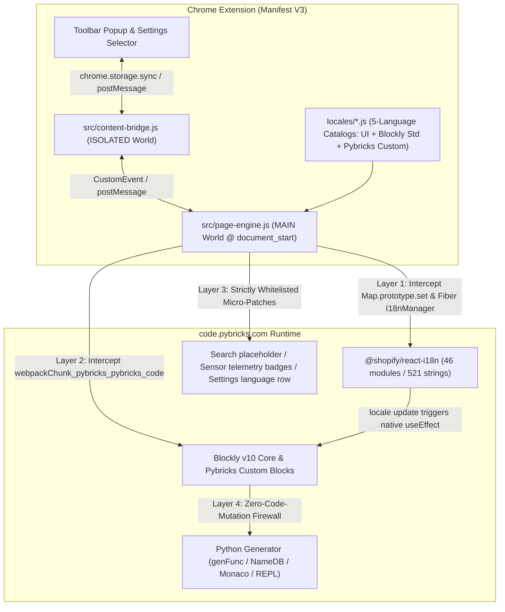
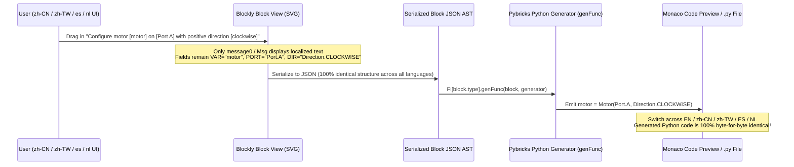

# Pybricks Code Multi-Language Chrome Extension — Architecture & Design Document

## 1. Background & Design Goals

**Pybricks Code** (`code.pybricks.com` / `beta.pybricks.com`) is the premier third-party MicroPython and block-based coding IDE for programmable LEGO® smart hubs (SPIKE™ Prime, SPIKE™ Essential, MINDSTORMS® Robot Inventor / EV3, Technic Hub, City Hub, and BOOST Move Hub). However, its production web app currently only exposes an English interface (`English`), creating a steep barrier for young makers, robotics competition teams (FLL / WRO), and classroom educators in Chinese-, Spanish-, and Dutch-speaking regions.

This project designs and implements a **Manifest V3 Chrome Extension** with three core engineering goals:

1. **100% String Coverage (UI + Blockly Programming Blocks)**: Full localization of the React interface, firmware flasher wizard, Bluetooth/USB diagnostic dialogs, Blockly toolbox categories, flyout group headers, block face text, dynamic mutator labels, and rich dropdown descriptions — with **live hot-switching without page reload** and **zero flash of untranslated content (Zero-FOUC)**.
2. **100% Zero-Code-Mutation Guarantee**: Regardless of the selected display language, the generated MicroPython source code in the preview/editor, function/variable identifiers, module imports, user string literals, REPL terminal output, and `.py` filenames remain **100% byte-for-byte identical**.
3. **Alignment with Official LEGO® Terminology**: High-quality localization catalogs in **Simplified Chinese (`zh-CN`)**, **Traditional Chinese (`zh-TW`)**, **Spanish (`es`)**, **Dutch (`nl`)**, and **English (`en`)**, strictly aligned with official terminology from **LEGO® Education SPIKE™ App**, **MINDSTORMS® Robot Inventor / EV3 Classroom**, and **Powered Up**.

---

## 2. Reverse-Engineering `code.pybricks.com` Production Bundles

Through static and runtime analysis of the production Webpack chunks (`main.js`, `4852.js`, `8475.js`), text rendering in Pybricks Code is governed by three distinct subsystems:

| Subsystem | Production Chunk | Native Mechanism | Production Status & Limitations |
| :--- | :--- | :--- | :--- |
| **React Main UI** | `main.js`, `4852.js` | `@shopify/react-i18n` `I18nManager` singleton (`pM`), reading `localStorage["pybricks-locale"]`, registering **46 `i18n_*` modules (521 leaf paths)** | Production builds strip async locale JSONs (`[].indexOf(e) < 0`), forcing all non-English locales to fall back to English; the Settings language selector is hardcoded hidden (`f = !1`). |
| **Hardcoded React UI Strings** | `main.js` | ~15 component props and constants not wired to `useI18n()` | File search input `Search...`, live sensor/vision telemetry badges (`reflection`, `ambient light`, `calibrate`, `score`, etc.), and BlueprintJS multistep dialog buttons (`Back`/`Next`/`Submit`) are hardcoded in English. |
| **Blockly Block System** | `8475.js` (Blockly v10)<br>`4852.js` (Pybricks blocks) | `vs(locale)` calls `Blockly.setLocale(...)` to inject **420 standard keys** + **491 custom keys**, followed by `Ss` (34 operator SVG icons) and `gs` (clearing C-block `"do"`/`"then"` labels) | 1. `ms` only contains `en` and a draft `nl`; `zh-CN`/`es` hit `!(e in ms)` and fall back to English.<br>2. **9 Setup/Variable/Task blocks** hardcode English words directly inside `message0` (e.g., `"%1 %2 %3 on %4 with forward %5"`).<br>3. **8 toolbox categories**, **33 flyout group labels**, and **5 `FieldLabel` mutator strings** are hardcoded in English. |

---

## 3. Four-Layer Non-Intrusive Localization Architecture

### 3.1 Why Global DOM Text Node Regex Replacement Is Strictly Forbidden

Many naive translation extensions use a `MutationObserver` to walk DOM text nodes and replace strings. In Pybricks Code, that approach causes catastrophic failures:
1. **Breaks React Virtual DOM Reconciliation**: `@shopify/react-i18n` heavily uses rich JSX interpolation (e.g., rendering `Turn the hub {on}.` as multiple sibling text/element nodes). Mutating those DOM nodes directly causes React state updates to crash with `NotFoundError: Failed to execute 'removeChild'`.
2. **Corrupts Blockly SVG Block Layout**: Blockly synchronously measures text bounding boxes (`getBBox()`) during block rendering to compute connector notches, inline input coordinates, and outer SVG paths. Mutating `<text>` nodes after the fact causes translated text to overflow block boundaries or overlap input fields.
3. **Risks Corrupting User Python Code**: Global text scanning can inadvertently alter Monaco editor code lines, variable name badges on blocks (e.g., translating Python variable `distance` into another language and breaking syntax), or terminal output.

To eliminate these risks, we designed a **4-Layer Native Framework Interception Architecture** that injects translations at the data source and lets React and Blockly perform their own native layout and rendering:



---

### 3.2 Layer 1: Native React UI Interception & Live Hot-Switching (Covers 98% of UI)

1. **Zero-FOUC Pre-Injection (`document_start`)**
   - Using Manifest V3 native `"world": "MAIN"` + `"run_at": "document_start"`, the extension loads all locale catalogs and `page-engine.js` synchronously before `main.js` executes — immune to page CSP restrictions and free of async race conditions.
   - When `main.js` initializes `pM` (`I18nManager`) and calls `pM.register({ id, fallback })` for each of the 46 UI modules, a lightweight prefix guard on `Map.prototype.set` (matching only keys starting with `"i18n_"`) intercepts registration:
     - When the key matches `i18n_<hash>`: records its English `fallback` tree. **Version-Resilient Synthesis**: Even if a future Pybricks release re-hashes module IDs into unknown `i18n_<newHash>` keys, the engine recursively walks the English `fallback` tree and synthesizes the localized dictionary tree on the fly using the leaf-string lookup table (`__PYBRICKS_I18N_UI_STRINGS__`).
     - When the key matches `i18n_<hash>__<locale>` and the original value is `undefined`: immediately injects the localized dictionary tree for that locale.
     - **BCP-47 Subtag Normalization**: Because Pybricks' internal helper `cM("zh-CN")` splits the locale into `["zh-CN", "zh"]` when querying `this.translations`, the engine normalizes both `"zh-CN"` and `"zh"` to the Simplified Chinese catalog, guaranteeing a 100% first-frame hit.

2. **Live Hot-Switching Without Page Reload**
   - Once the page mounts, the engine walks up to 5 levels of the `#root` React Fiber tree (`_reactRootContainer` / `__reactContainer$*`) to locate `<I18nContext.Provider value={pM}>` and capture a direct reference to the live `pM` instance.
   - When the user switches languages:
     1. Updates `localStorage.setItem("pybricks-locale", newLocale)`;
     2. Pre-populates all 46 module translation trees for `newLocale` into `pM.translations`;
     3. Calls `pM.update({ ...pM.details, locale: newLocale })`.
   - **Native React + Blockly Cascade**: `pM.update` automatically triggers a re-render of every `useI18n()` component across the app (preserving all `{variable}` interpolations and embedded React components/links). Furthermore, because the Blockly editor component `ys` in `4852.js` includes `E.locale` in its `useEffect` dependency array, React **automatically disposes of the old Blockly canvas and losslessly rebuilds the entire Blockly workspace in the new language** without reloading the page.

---

### 3.3 Layer 2: Blockly Engine & Custom Block AST-Safe Hooks

By intercepting `self.webpackChunk_pybricks_pybricks_code.push` and wrapping module factories, the engine attaches 6 surgical hooks at the exact moment the Blockly core module (exporting `Msg`, `setLocale`, and `common.defineBlocksWithJsonArray`) initializes — **before `4852.js` registers any Pybricks blocks**:

| Hook Point | Problem Solved | Mechanism & Safety Analysis |
| :--- | :--- | :--- |
| **1. `Blockly.common.defineBlocksWithJsonArray`** | 9 Setup/Variable/Color/Task blocks hardcode English prepositions in `message0` (e.g., `"%1 %2 %3 on %4 with forward %5"`) | Upgrades those 9 `message0` strings to dynamic references `"%{BKY_PB_EXT_...}"` before block definition. Uses Blockly's native `tokenizeInterpolation` so each language can reorder `%1..%7` naturally while `args0` order, field `name`s, and `genFunc` remain untouched. |
| **2. `Blockly.setLocale`** | `vs(locale)` falls back to English when `ms` lacks `zh-CN`/`es`, and calls `setLocale` multiple times | Wraps `setLocale` to overlay `BKY_STD[locale]` (420 keys + cross-tab copy/paste menu strings) and `BKY_CUSTOM[locale]` (504 keys). **Two strict safeguards**: (1) Never overwrites `data:image/svg+xml` math/logic operator icons in `Ss`; (2) Preserves `gs` clearing `CONTROLS_REPEAT_INPUT_DO` and `CONTROLS_IF_MSG_THEN` for clean Scratch/SPIKE-style C-blocks. |
| **3. `ToolboxCategory.prototype.createLabelDom_`** | 8 left-hand toolbox categories (`Setup`, `Output`, `Input`, etc.) are hardcoded in English | Replaces only the visible DOM `<span>` label text while keeping internal `this.name_` in English so category CSS icons and the dynamic `Variables` flyout callback (`custom: "Variables"`) work identically. |
| **4. `FlyoutButton.prototype.createDom`** | 33 flyout section headers (`Set up smart motors`, `Drive Base`, etc.) bypass `Blockly.Msg` | When `this.isLabel_ === true`, translates `this.text` **before** `createDom` creates the SVG `<text>` node and calls `getBBox()`, ensuring accurate flyout width calculation. |
| **5. `FieldLabel.prototype.setValue`** | List blocks (`empty list` / `list with`) and `range` blocks (`from` / `to` / `with steps of`) dynamically rewrite label text inside mutators | Strictly checks `!this.SERIALIZABLE` (affecting only non-serializable display syntax labels, never `FieldLabelSerializable` or variable fields), maps the 5 syntax phrases to the active language, and marks `isDirty_` so the block SVG reflows cleanly. |
| **6. `fieldRegistry.register("field_dropdown_more_details")`** | Pybricks custom detailed dropdowns need live translation updates on language switch | Dynamically resolves short labels and detailed descriptions from `Blockly.Msg` when opened, while internal `getValue()` always returns the raw enum constant (e.g., `"Stop.HOLD"`). |

---

### 3.4 Layer 3: Whitelisted UI Micro-Patches & Language Switcher UX

For the handful of UI elements not wired to `@shopify/react-i18n`, a lightweight observer applies patches restricted to a **strict CSS selector whitelist**:
- **File Tree Search Input**: Matches `.rct-tree-search-input-container input` to localize the `placeholder` (`Search...` → `搜索文件…` / `搜尋檔案…` / `Buscar archivos…` / `Bestanden zoeken…`).
- **Live Sensor Telemetry & AI Camera Overlay**: Matches status-bar/dialog telemetry mode labels and SVG overlay badges (`reflection`, `ambient light`, `calibrate`, `score`, `width`, `height`, etc.).
- **Multistep Wizard Footer Buttons**: Matches default BlueprintJS buttons inside `.bp5-multistep-dialog-footer`.
- **Dual Language Switcher Entry Points**:
  1. **Native Settings Panel Integration**: Automatically injects a BlueprintJS-styled **Language** dropdown directly beneath the "Appearance" section inside the right-hand Settings & Help drawer (`.pb-settings`).
  2. **Quick Access Controls**: Provides a browser toolbar **Popup window** plus an optional collapsible bottom-right in-page quick switcher pill (`EN` / `简中` / `繁中` / `ES` / `NL`).

---

### 3.5 Layer 4: Four-Fold Firewall Guaranteeing Zero Python Code Mutation



We enforce a **four-fold architectural firewall** to guarantee that user Python code is never modified:

1. **Complete Decoupling of Code Generation**: Pybricks' Python generator (`Fi[block.type].genFunc`) constructs code exclusively from `block.type`, invariant field names (`PORT`, `THEN`, `VAR`), and invariant enum keys (`"Stop.BRAKE"`, `"Port.A"`, `"SENSOR_FORCE"`). It never reads `Blockly.Msg` or any visible label text.
2. **Zero Touch on Python Identifiers & User Input Fields**:
   - Default Setup object variable names (`prime_hub`, `motor`, `drive_base`, `color_sensor`, etc., converted by `NameDB_` into valid `snake_case` Python identifiers) **remain in English**;
   - Custom task function names (`main`), imported module names (`my_module`), free-text string inputs (`FieldTextInput`), and physical units (`ms`, `°/s`, `mm`, `Hz`, `%`) **are never translated**.
3. **Lossless Cross-Language Serialization**: A `.py` block program created and exported in Chinese, Spanish, or Dutch opens seamlessly in an unmodified English Pybricks environment (and vice versa), producing **100% byte-for-byte identical** Python code.
4. **Strict DOM Subtree Blacklist**: Before inspecting any node, Layer 3 micro-patches short-circuit and skip any element inside:
   - `.monaco-editor`, `.pb-editor-monaco` (Python code editor and read-only code preview pane)
   - `.xterm`, `.pb-terminal` (MicroPython REPL terminal and `print` output)
   - `.rct-tree-items-container`, `.rct-tree-item-button` (user `.py` file list)
   - `.blocklyEditableText`, `code`, `pre`, `textarea` (editable literals, variable badges, and code snippets)

---

## 4. Multi-Language Terminology System (Aligned with Official LEGO® Ecosystem)

### 4.1 Reference Standards

All translations were cross-checked against official localization glossaries across the LEGO® robotics software ecosystem:
- **LEGO® Education SPIKE™ App (v3)**: Official Simplified Chinese, Traditional Chinese, Spanish, and Dutch block and hardware terminology;
- **LEGO® MINDSTORMS® Robot Inventor / EV3 Classroom**: Smart Hub, IMU orientation (pitch/roll/yaw), line following, and motor control terminology;
- **LEGO® Powered Up App** & **Google Blockly Standard Multi-Language Catalogs**.

### 4.2 Core Robotics & Blockly 5-Language Terminology Matrix

| English Source (Pybricks) | Simplified Chinese (`zh-CN`) | Traditional Chinese (`zh-TW`) | Spanish (`es`) | Dutch (`nl`) | Reference & Design Rationale |
| :--- | :--- | :--- | :--- | :--- | :--- |
| **Hub** | 集线器（EV3/NXT 称主机） | 主機（EV3/NXT 稱主機） | Hub（EV3/NXT: bloque） | Hub（EV3/NXT: steen） | Aligned with official LEGO Education SPIKE terminology ("集线器" in Mainland China, "主機" in Taiwan/HK) |
| **Drive Base** | 驾驶底座 | 駕駛底座 | Base motriz | Rijbasis | 100% matches official SPIKE Prime movement module terminology |
| **Smart Motor / Basic Motor** | 智能电机 / 基础电机 | 智慧馬達 / 基本馬達 | Motor inteligente / Motor básico | Slimme motor / Basismotor | Distinguishes encoder-equipped smart motors from DC motors per SPIKE / Powered Up conventions |
| **Port A / Sensor Port 1** | 端口 A / 传感器端口 1 | 連接埠 A / 感測器連接埠 1 | Puerto A / Puerto de sensor 1 | Poort A / Sensorpoort 1 | Translates only dropdown display labels; generated code stays `Port.A` / `Port.S1` |
| **coast / brake / hold / continue** | 滑行 / 刹停 / 保持位置 / 继续运动 | 滑行 / 煞車 / 保持位置 / 繼續動作 | inercia / frenar / mantener posición / continuar | uitrollen / remmen / vasthouden / doorgaan | Matches the classic SPIKE motor stop modes (free coast, passive braking, closed-loop hold) |
| **until stalled (to end stop)** | 直到堵转限位 | 直到卡住（機械限位） | hasta el tope | tot aanslag (geblokkeerd) | Standard robotics competition term for mechanical homing against a physical hard stop |
| **pitch / roll / heading (yaw)** | 俯仰角 / 翻滚角 / 偏航角（航向） | 俯仰角 (pitch) / 翻滾角 (roll) / 偏航角（航向） | cabeceo (pitch) / alabeo (roll) / rumbo | pitch (helling) / roll (kanteling) / richtingshoek | Aligned with SPIKE 3-axis IMU gyro terminology, retaining bilingual hints where helpful in classrooms |
| **reflected light / ambient light** | 反射光强度 / 环境光强度 | 反射光強度 / 環境光強度 | luz reflejada / luz ambiental | gereflecteerd licht / omgevingslicht | Matches EV3 and SPIKE Color Sensor optical measurement modes |
| **Color Sensor / Ultrasonic / Force** | 颜色传感器 / 超声波传感器 / 压力传感器 | 顏色感測器 / 超音波感測器 / 壓力感測器 | Sensor de color / ultrasónico / de fuerza | Kleurensensor / Ultrasone sensor / Krachtsensor | Consistent official LEGO hardware peripheral names |
| **Multitask (all / one task)** | 多任务并行（全部任务 / 任一任务） | 多工並行（全部任務 / 任一任務） | Multitarea (todas / una tarea) | Multitask (alles / één taak) | Clearly conveys Pybricks coroutine concurrency (await all tasks vs. race and cancel remaining) |
| **Setup / Output / Input / Flow / Data / Tasks / Variables / Other** | 配置 / 输出 / 输入 / 控制 / 数据与运算 / 任务 / 变量 / 其他 | 設定 / 輸出 / 輸入 / 控制 / 資料與運算 / 任務 / 變數 / 其他 | Configuración / Salida / Entrada / Control / Datos / Tareas / Variables / Otros | Instellen / Uitvoer / Invoer / Besturing / Gegevens / Taken / Variabelen / Overig | Concise labels for the 8 left-hand toolbox categories aligned with SPIKE "Control/Flow" conventions |

### 4.3 Audit & Quality Upgrade of Pybricks' Incomplete Draft Dutch (`nl`)

During reverse engineering, we discovered an unreleased draft Dutch block translation embedded inside `4852.js`. We audited and upgraded it to full production quality:
1. **100% Missing UI Layer Completed**: None of the 46 React UI modules (521 strings) had Dutch translations; all 521 strings are now translated into natural, idiomatic Dutch.
2. **Fixed Typos & Untranslated Remnants**: Fixed typos in the draft (such as `willekeurge` → `willekeurige` and missing periods) and completed untranslated Xbox controller buttons (`VIEW` → `weergave`, `GUIDE` → `gids`, `UPLOAD` → `delen`), all 9 Setup/Variable/Task block templates, 8 toolbox categories, and 33 flyout group headers.

---

## 5. Repository Structure & SSOT CSV Build Pipeline

All five language catalogs pass **100% key coverage and placeholder (`%1..%7` and `{variable}`) validation**:

```text
pybricks_i18n/
├── DESIGN.md                    # Architecture & localization specification document
├── README.md                    # Quick-start installation & developer guide
├── STORE_LISTING.md             # Chrome Web Store submission & privacy compliance guide
├── manifest.json                # Chrome Extension Manifest V3 configuration
├── _locales/                    # Chrome Web Store multi-language manifest metadata (en/zh_CN/zh_TW/es/nl)
├── icons/                       # Extension icons (16 / 32 / 48 / 128 px)
├── locales/
│   ├── schema.json              # Structural schema (message0Upgrades, fieldLabels, uiCatalogEnTree)
│   ├── en.csv                   # English source table (1,467 rows, UTF-8 BOM, RFC-4180)
│   ├── zh-CN.csv                # Simplified Chinese table (1,467 rows, UTF-8 BOM, RFC-4180)
│   ├── zh-TW.csv                # Traditional Chinese table (1,467 rows, UTF-8 BOM, RFC-4180)
│   ├── es.csv                   # Spanish table (1,467 rows, UTF-8 BOM, RFC-4180)
│   ├── nl.csv                   # Dutch table (1,467 rows, UTF-8 BOM, RFC-4180)
│   ├── blockly-std.js           # Compiled Google Blockly v10 catalog (420 keys × 5 locales = 2,100 entries)
│   ├── blockly-pybricks.js      # Compiled Pybricks custom catalog (504 keys + 9 templates + 8 categories + 33 headers × 5 locales)
│   └── ui-catalog.js            # Compiled React UI catalog (46 modules / 521 paths + fallback map + DOM patches × 5 locales)
├── scripts/
│   ├── build-locales.mjs        # Zero-dependency CSV compiler & placeholder validator
│   └── package-extension.mjs    # Automated dist/ & release/*.zip packager
├── src/
│   ├── page-engine.js           # MAIN World 4-layer interception & live hot-switching engine (@ document_start)
│   ├── content-bridge.js        # ISOLATED World storage sync & Popup messaging bridge
│   ├── styles.css               # BlueprintJS-native language selector & typography styles
│   ├── popup.html               # Browser toolbar language switcher popup view
│   └── popup.js                 # Popup state synchronization & instant language switching logic
└── tests/
    └── verify-all.mjs           # End-to-end verification suite against real Pybricks production bundles
```

### 5.1 Single Source of Truth (SSOT) CSV Workflow

To make translation review effortless for educators and native speakers, all translations live in **standalone CSV files (`locales/<locale>.csv`)**:
1. **Spreadsheet-Friendly Format**:
   - Prefixed with a UTF-8 BOM (`\uFEFF`) so Microsoft Excel, Apple Numbers, and LibreOffice open them without encoding corruption;
   - Strictly RFC-4180 compliant (fields containing commas, quotes, or newlines are double-quoted);
   - Standardized 4-column layout: `section,key,en,translation`;
   - Contains 1,467 rows per locale across `meta` (3), `bky_std` (420), `bky_custom` (504), `toolbox_categories` (8), `flyout_labels` (33), `ui_strings` (468), `ui_overrides` (4), and `dom_patches` (27).
2. **Zero-Dependency Compiler & Strict Validator (`scripts/build-locales.mjs`)**:
   - Running `npm run build` reads `locales/schema.json` and all `locales/*.csv` files;
   - Enforces 100% key coverage and exact `%1..%7` and `{variable}` placeholder parity, reporting exact row numbers and keys on any mismatch;
   - Deterministically generates `locales/blockly-std.js`, `locales/blockly-pybricks.js`, and `locales/ui-catalog.js`.

---

## 6. Automated Verification Against Real Production Bundles

`tests/verify-all.mjs` loads the actual `code.pybricks.com` production bundles (`main.js` + `4852.js` + `8475.js`) and executes three automated verification suites:
1. **Catalog Completeness & Placeholder Parity**: Verifies all 46 UI modules and 924 Blockly keys across `en`, `zh-CN`, `zh-TW`, `es`, and `nl` for zero missing translations, `undefined` values, or dropped `%N` / `{var}` placeholders.
2. **Live UI & Blockly Hot-Switching Simulation**: Simulates `I18nManager` registration, initial render, and live runtime switching across `en → zh-CN → zh-TW → es → nl → en`, asserting that all UI modules, toolbox categories, flyout headers, and `FieldLabel` mutators update in real time.
3. **Byte-for-Byte Python Code Identity Assertion (Core Red-Line Metric)**: Loads a comprehensive block program (covering hubs, motors, drive base, color/force sensors, multitasking coroutines, loops, conditionals, lists, and variables) into the real Blockly + Pybricks `pythonGenerator` runtime, executes `workspaceToCode()` across all five languages (`en`, `zh-CN`, `zh-TW`, `es`, `nl`), and asserts that the generated MicroPython code is **100% byte-for-byte identical**.
