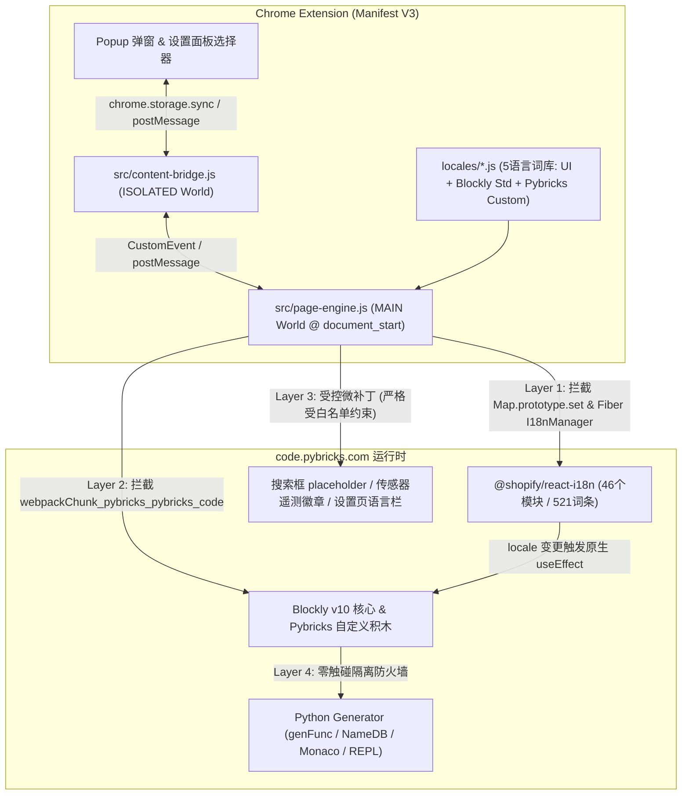
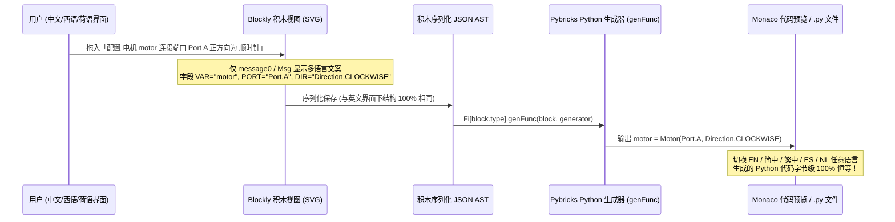

# Pybricks Code 多语言 Chrome 扩展设计文档

## 1. 背景与设计目标

**Pybricks Code**（`code.pybricks.com` / `beta.pybricks.com`）是乐高可编程智能集线器（SPIKE Prime、SPIKE Essential、MINDSTORMS Robot Inventor / EV3、Technic Hub、City Hub、BOOST Move Hub）最核心的第三方 MicroPython 与积木编程 IDE。然而其线上生产环境目前仅开放英文界面（`English`），给中文、西语及荷语区的青少年创客、赛队（FLL / WRO）和课堂教学带来较高门槛。

本项目设计并实现一个 **Manifest V3 Chrome 浏览器扩展**，核心目标如下：

1. **全量词条替换（UI + Blockly 编程积木）**：完整覆盖 React 界面、固件刷写向导、蓝牙/USB 诊断弹窗、Blockly 工具箱分类、抽屉分组标题、积木表面文案、动态变形器（Mutator）标签及下拉菜单说明，支持**免刷新实时热切换**与**首屏零闪烁（Zero-FOUC）**。
2. **绝对不触碰 Python 代码（Zero-Code-Mutation）**：无论切换到何种显示语言，右侧预览或编辑器中的 MicroPython 源码、函数/变量标识符、模块导入名、用户字符串字面量、REPL 终端输出及 `.py` 文件名均保持 **100% 字节级原样不变**。
3. **对齐乐高官方多语言术语体系**：提供 **简体中文（`zh-CN`）**、**繁体中文（`zh-TW`）**、**西班牙语（`es`）**、**荷兰语（`nl`）** 及 **英语（`en`）** 五语高质量词库，严格参考 **LEGO Education SPIKE App**、**MINDSTORMS Robot Inventor / EV3 Classroom** 与 **Powered Up** 官方多语言译法。

---

## 2. `code.pybricks.com` 生产包逆向分析

通过对线上生产构建产物（`main.js`、`4852.js`、`8475.js` 等 Webpack Chunks）的静态与运行时逆向分析，Pybricks Code 的文本渲染由以下三套机制构成：

| 子系统 | 所在构建分包 | 原生实现机制 | 线上生产环境现状与痛点 |
| :--- | :--- | :--- | :--- |
| **React 主界面 UI** | `main.js`、`4852.js` | 基于 `@shopify/react-i18n` 的 `I18nManager` 单例（`pM`），读取 `localStorage["pybricks-locale"]`，共注册 **46 个 `i18n_*` 模块（521 条叶节点路径）** | 生产构建剔除了异步语言 JSON（`[].indexOf(e) < 0`），非英语全部回退英文 fallback；设置面板中的语言切换器被硬编码隐藏（`f = !1`） |
| **React 遗漏硬编码 UI** | `main.js` | 未接入 `useI18n()` 的少量组件属性与常量（约 **15 处**） | 文件搜索框 `Search...`、传感器/视觉实时遥测标签（`reflection`、`ambient light`、`calibrate`、`score` 等）、BlueprintJS 向导默认按钮（`Back`/`Next`/`Submit`）硬编码为英文 |
| **Blockly 编程积木系统** | `8475.js`（Blockly v10）<br>`4852.js`（Pybricks 积木） | `vs(locale)` 调用 `Blockly.setLocale(...)` 注入 **420 条标准词条** + **491 条自定义词条**，同时注入 `Ss`（34 个算符 SVG 图标）与 `gs`（清空 C 型积木 `"do"`/`"then"`） | 1. `ms` 仅含 `en` 和草稿版 `nl`，`zh-CN`/`es` 直接触发 `!(e in ms)` 回退英文；<br>2. **9 个 Setup/变量/任务积木**在 `message0` 中硬编码了英文（如 `"%1 %2 %3 on %4 with forward %5"`）；<br>3. **8 个工具箱分类**、**33 个抽屉分组标签**、**5 个 `FieldLabel` 变形器词条**硬编码为英文 |

---

## 3. 词条替换逻辑设计（四层零侵入架构）

### 3.1 为什么严禁使用“全局 DOM 文本节点正则替换”？

许多简易翻译插件采用 `MutationObserver` 遍历文本节点替换字符串，但在 Pybricks Code 中会导致灾难性后果：
1. **破坏 React 虚拟 DOM 协调（Reconciliation）**：`@shopify/react-i18n` 大量使用富文本插值（如 `Turn the hub {on}.` 渲染为多个相邻文本/元素节点），直接篡改 DOM 会导致 React 更新状态时抛出 `NotFoundError: Failed to execute 'removeChild'` 崩溃。
2. **Blockly SVG 积木排版错乱**：Blockly 在渲染积木时同步测量文本宽度以计算连接槽、内联输入框坐标与外框 SVG 路径（Path）。事后篡改 `<text>` 节点会导致中文/西语长文本溢出积木边界或遮挡输入框。
3. **极易污染 Python 代码**：全局文本扫描极易误改 Monaco 编辑器代码行、积木上的变量名徽章（如将 Python 变量 `distance` 误改为中文导致语法错误）或终端输出。

因此，我们设计了**框架原生级四层拦截架构**，在数据源头完成多语言注入，由 React 与 Blockly 自身完成排版与渲染：



---

### 3.2 Layer 1：React UI 原生级拦截与免刷新热切换（覆盖 98% UI）

1. **首屏零闪烁预注入（`document_start` 阶段）**
   - 扩展通过 Manifest V3 原生 `"world": "MAIN"` + `"run_at": "document_start"`，保证词库与 `page-engine.js` 在 `main.js` 执行前同步加载完毕，完全不受页面 CSP 限制且无异步竞态。
   - 在 `main.js` 初始化 `pM`（`I18nManager`）并调用 46 次 `pM.register({ id, fallback })` 时，我们对 `Map.prototype.set` 设置极轻量前缀守卫（仅匹配以 `"i18n_"` 开头的键）：
     - 当键形如 `i18n_<hash>` 时：自动记录其英文 `fallback` 树。**抗版本升级机制**：即使未来 Pybricks 发版导致 Webpack 重新哈希生成未知的 `i18n_<newHash>`，引擎也会递归遍历该英文 `fallback` 树，通过英文叶节点映射表（`__PYBRICKS_I18N_UI_STRINGS__`）实时合成翻译树。
     - 当键形如 `i18n_<hash>__<locale>` 且原返回值为 `undefined` 时：立即注入对应语言的翻译字典树。
     - **BCP-47 子标签兼容细节**：Pybricks 内部函数 `cM("zh-CN")` 会拆分为 `["zh-CN", "zh"]` 双键依次查询 `this.translations`，因此引擎对 `"zh-CN"` 与 `"zh"` 同步归一化到简体中文词库，确保首帧 100% 命中。

2. **免刷新实时热切换（Live Hot-Switch）**
   - 页面挂载后，引擎从 `#root` 的 React Fiber 树（`_reactRootContainer` / `__reactContainer$*`）向上/向下扫描 5 层以内即可定位 `<I18nContext.Provider value={pM}>`，拿到 `pM` 实例引用。
   - 当用户切换语言时：
     1. 更新 `localStorage.setItem("pybricks-locale", newLocale)`；
     2. 将新语言的 46 个模块字典预写入 `pM.translations`；
     3. 调用 `pM.update({ ...pM.details, locale: newLocale })`。
   - **原生联动效果**：`pM.update` 会自动通知全站所有 `useI18n()` 组件重渲染（保留全部 `{variable}` 参数与内嵌按钮/链接组件），同时由于 `4852.js` 中积木面板组件 `ys` 的 `useEffect` 依赖数组包含 `E.locale`，React 会**自动销毁旧积木画布并按新语言无损重建整个 Blockly 工作区**，无需刷新网页！

---

### 3.3 Layer 2：Blockly 引擎与自定义积木 AST 安全替换逻辑

通过拦截 `self.webpackChunk_pybricks_pybricks_code.push` 并包装模块工厂函数，我们在 Blockly 核心模块（导出含 `Msg`、`setLocale`、`common.defineBlocksWithJsonArray` 的单例对象）初始化完成瞬间、**早于 `4852.js` 注册任何 Pybricks 积木之前**，挂载 6 个精准钩子：

| 钩子点 | 解决的问题 | 替换机制与安全性分析 |
| :--- | :--- | :--- |
| **1. `Blockly.common.defineBlocksWithJsonArray`** | 9 个 Setup/变量/颜色/任务积木在 `message0` 中硬编码了英文单词（如 `"%1 %2 %3 on %4 with forward %5"`） | 在定义积木前将这 9 条 `message0` 替换为动态引用 `"%{BKY_PB_EXT_...}"`。利用 Blockly 原生 `tokenizeInterpolation` 支持各语言自由调整 `%1..%7` 语序（如中文 `"%1 %2 将 %3 设为 %4"`），而 `args0` 数组顺序、字段 `name` 与 `genFunc` 完全不变。 |
| **2. `Blockly.setLocale`** | `vs(locale)` 因 `ms` 缺少 `zh-CN`/`es` 自动回退英文，且会连续调用多次 `setLocale` | 包装 `setLocale`：在原调用后叠加 `BKY_STD[locale]`（420 键 + 跨标签页复制粘贴菜单）与 `BKY_CUSTOM[locale]`（504 键）。**两项严格保护**：① 绝不覆盖 `Ss` 中的 `data:image/svg+xml` 数学/逻辑算符图标；② 保留 `gs` 将 `CONTROLS_REPEAT_INPUT_DO` 与 `CONTROLS_IF_MSG_THEN` 置空的设计，维持类 Scratch/SPIKE 的清爽 C 型积木外观。 |
| **3. `ToolboxCategory.prototype.createLabelDom_`** | 左侧工具箱 8 大分类（`Setup`、`Output`、`Input` 等）硬编码为英文 | 仅在生成左侧 DOM `<span>` 时将显示文本替换为对应语言，**内部 `this.name_` 保持英文不变**，确保分类图标匹配与 `Variables` 动态抽屉回调（`custom: "Variables"`）100% 正常工作。 |
| **4. `FlyoutButton.prototype.createDom`** | 积木抽屉内 33 个分组小标题（如 `Set up smart motors`、`Drive Base`）未走 `Msg` | 当 `this.isLabel_ === true` 时，在 `createDom` 创建 SVG `<text>` 并调用 `getBBox()` 测量宽度**之前**替换 `this.text`，保证抽屉自动算出准确宽度。 |
| **5. `FieldLabel.prototype.setValue`** | 列表积木（`empty list` / `list with`）与 `range` 积木（`from` / `to` / `with steps of`）在变形器中动态改写文本 | 严格检查 `!this.SERIALIZABLE`（仅限不可序列化的纯展示语法标签，绝不触碰 `FieldLabelSerializable` 或变量字段），将上述 5 个英文语法词映射为当前语言，自动触发 `isDirty_` 让积木外框重新自适应伸缩。 |
| **6. `fieldRegistry.register("field_dropdown_more_details")`** | Pybricks 自定义带详细说明的下拉框在切换语言后需实时解析新译文 | 确保下拉菜单展开时动态从当前 `Blockly.Msg` 解析显示短词与详细描述（如 `Stop.HOLD` 显示“保持位置 — 锁定并保持当前角度位置”），而内部存储值 `getValue()` 始终保持 `"Stop.HOLD"`。 |

---

### 3.4 Layer 3：遗漏硬编码 UI 微补丁与语言切换交互设计

针对未接入 `@shopify/react-i18n` 的少量界面元素，采用**严格限定 CSS 选择器白名单**的轻量观察器修补：
- **文件树搜索框**：精确匹配 `.rct-tree-search-input-container input`，替换 `placeholder`（`Search...` → `搜索文件…` / `Buscar archivos…` / `Bestanden zoeken…`）。
- **传感器实时遥测与 AI 摄像头浮层**：精确匹配状态栏/弹窗内的遥测模式标签与 SVG 浮层标签（`reflection`、`ambient light`、`calibrate`、`score`、`width`、`height` 等）。
- **向导默认按钮**：精确匹配 `.bp5-multistep-dialog-footer` 中的默认按钮文本。
- **双入口语言切换 UI**：
  1. **原生融合式设置项**：当用户打开右侧“设置与帮助”（`.pb-settings`）面板时，在“界面外观”下方自动注入与原生 BlueprintJS 视觉完全一致的**语言选择下拉框**；
  2. **便捷切换入口**：提供浏览器扩展栏 **Popup 弹窗面板** + 页面内可折叠的轻量语言快捷切换胶囊（支持 `EN` / `简中` / `繁中` / `ES` / `NL` 一键秒切）。

---

### 3.5 Layer 4：“绝不修改 Python 代码”的四重防火墙证明



我们从架构根源上建立了**四重防火墙**，确保 Python 代码绝对安全：

1. **代码生成逻辑完全解耦**：Pybricks 的 Python 生成器（`Fi[block.type].genFunc`）仅依据 `block.type`、不变的字段名（如 `PORT`、`THEN`、`VAR`）和不变的内部枚举键值（如 `"Stop.BRAKE"`、`"Port.A"`、`"SENSOR_FORCE"`）拼接代码，完全不读取 `Blockly.Msg` 或任何标签显示文本。
2. **Python 标识符与用户输入字段零触碰**：
   - Setup 积木的默认对象变量名（`prime_hub`、`motor`、`drive_base`、`color_sensor` 等，由 `NameDB_` 转为合法的 `snake_case` Python 标识符）**保持英文原样不翻译**；
   - 自定义任务函数名（`main`）、外部导入模块名（`my_module`）、字符串输入框（`FieldTextInput`）、数值与单位（`ms`、`°/s`、`mm`、`Hz`、`%`）**一律不翻译**。
3. **积木文件序列化无损互通**：用中文/西语/荷语界面编写并导出的 `.py` 积木程序，发给未安装扩展的英文原版用户打开，或在不同语言间来回切换，积木结构与生成的 Python 代码 **100% 字节级一致**。
4. **DOM 黑名单禁区（Subtree Blacklist）**：Layer 3 微补丁在遍历任何节点前强制执行禁区短路检查，一旦祖先或自身命中以下选择器立即跳过：
   - `.monaco-editor`、`.pb-editor-monaco`（Python 代码编辑器与只读代码预览窗）
   - `.xterm`、`.pb-terminal`（MicroPython REPL 交互终端与 `print` 输出）
   - `.rct-tree-items-container`、`.rct-tree-item-button`（用户 `.py` 文件名列表）
   - `.blocklyEditableText`、`code`、`pre`、`textarea`（可编辑字面量、变量名徽章与代码片段）

---

## 4. 多语言翻译体系设计（对标乐高官方软件系统）

### 4.1 术语参考基准

所有译文均交叉核对了以下乐高官方编程生态的多语言本地化规范，避免生硬机翻：
- **LEGO® Education SPIKE™ App（v3）**：简体中文、繁体中文、西班牙语、荷兰语官方积木与硬件词表；
- **LEGO® MINDSTORMS® Robot Inventor / EV3 Classroom**：智能集线器/主機、姿态传感器（俯仰/翻滚/偏航）、巡线与电机控制术语；
- **LEGO® Powered Up App** & **Google Blockly 官方多语言标准库**。

### 4.2 核心机器人与积木编程五语对照规范表

| 英文原词 (Pybricks) | 简体中文 (`zh-CN`) | 繁体中文 (`zh-TW`) | 西班牙语 (`es`) | 荷兰语 (`nl`) | 参考依据与设计说明 |
| :--- | :--- | :--- | :--- | :--- | :--- |
| **Hub** | 集线器（EV3/NXT 称主机） | 主機（EV3/NXT 稱主機） | Hub（EV3/NXT: bloque） | Hub（EV3/NXT: steen） | 对齐 LEGO Education SPIKE 官方标准译名（大陆“智能集线器”，台湾/香港“主機”） |
| **Drive Base** | 驾驶底座 | 駕駛底座 | Base motriz | Rijbasis | 100% 采用 SPIKE Prime 官方运动模块专有名词 |
| **Smart Motor / Basic Motor** | 智能电机 / 基础电机 | 智慧馬達 / 基本馬達 | Motor inteligente / Motor básico | Slimme motor / Basismotor | 对齐 SPIKE / Powered Up 带编码器电机与普通直流电机区分（台湾称馬達） |
| **Port A / Sensor Port 1** | 端口 A / 传感器端口 1 | 連接埠 A / 感測器連接埠 1 | Puerto A / Puerto de sensor 1 | Poort A / Sensorpoort 1 | 仅翻译下拉显示文本，生成代码仍为 `Port.A` / `Port.S1` |
| **coast / brake / hold / continue** | 滑行 / 刹停 / 保持位置 / 继续运动 | 滑行 / 煞車 / 保持位置 / 繼續動作 | inercia / frenar / mantener posición / continuar | uitrollen / remmen / vasthouden / doorgaan | 对齐 SPIKE 电机停止模式三大经典状态（自由滑行、被动阻尼刹停、闭环锁死保持位置） |
| **until stalled (to end stop)** | 直到堵转限位 | 直到卡住（機械限位） | hasta el tope | tot aanslag (geblokkeerd) | 机器人竞赛常用机械归零动作，中文采用赛队通用词“堵转/卡住限位” |
| **pitch / roll / heading (yaw)** | 俯仰角 / 翻滚角 / 偏航角（航向） | 俯仰角 (pitch) / 翻滾角 (roll) / 偏航角（航向） | cabeceo (pitch) / alabeo (roll) / rumbo | pitch (helling) / roll (kanteling) / richtingshoek | 对齐 SPIKE 陀螺仪三轴姿态教学术语，西语/荷语/繁中保留课堂常用双语提示 |
| **reflected light / ambient light** | 反射光强度 / 环境光强度 | 反射光強度 / 環境光強度 | luz reflejada / luz ambiental | gereflecteerd licht / omgevingslicht | 对齐 EV3 与 SPIKE 颜色传感器两大光学测量模式 |
| **Color Sensor / Ultrasonic / Force** | 颜色传感器 / 超声波传感器 / 压力传感器 | 顏色感測器 / 超音波感測器 / 壓力感測器 | Sensor de color / ultrasónico / de fuerza | Kleurensensor / Ultrasone sensor / Krachtsensor | 严格一致的 LEGO 硬件外设译名（台湾标准“感測器”） |
| **Multitask (all / one task)** | 多任务并行（全部任务 / 任一任务） | 多工並行（全部任務 / 任一任務） | Multitarea (todas / una tarea) | Multitask (alles / één taak) | 准确表达 Pybricks 协程并发等待全部完成或竞态取消其余任务的语义 |
| **Setup / Output / Input / Flow / Data / Tasks / Variables / Other** | 配置 / 输出 / 输入 / 控制 / 数据与运算 / 任务 / 变量 / 其他 | 設定 / 輸出 / 輸入 / 控制 / 資料與運算 / 任務 / 變數 / 其他 | Configuración / Salida / Entrada / Control / Datos / Tareas / Variables / Otros | Instellen / Uitvoer / Invoer / Besturing / Gegevens / Taken / Variabelen / Overig | 左侧工具箱 8 大积木分类，兼顾简洁宽度与 SPIKE“控制(Flow/Control)”习惯 |

### 4.3 对 Pybricks 原生残缺荷兰语（`nl`）的审计与品质升级

逆向过程中我们发现 `4852.js` 内含有一份未正式开放的荷兰语积木初稿，但存在以下缺陷，我们已在词库中全面修复并补齐：
1. **UI 层完全缺失**：全部 46 个 React UI 模块（521 条界面词条）原本无荷兰语翻译，现已 100% 补齐地道荷兰语；
2. **修正原稿拼写错误与未翻译残留**：修复了原稿中的拼写笔误（如 `willekeurge` → `willekeurige`、缺失句号等），补齐了 Xbox 手柄按键（`VIEW` → `weergave`、`GUIDE` → `gids`、`UPLOAD` → `delen`）以及全部 9 个 Setup/变量/任务积木模板、8 个分类名与 33 个抽屉分组标题。

---

## 5. 词库与工程模块结构

目前五大语言核心词库已完成构建并通过了 **100% 键覆盖率与占位符（`%1..%7` 及 `{variable}`）零误差校验**：

```text
pybricks_i18n/
├── DESIGN.md                    # 本架构与翻译规范设计文档
├── manifest.json                # Chrome Extension Manifest V3 配置 (code/beta.pybricks.com)
├── icons/                       # 扩展多尺寸高清图标 (16 / 32 / 48 / 128 px)
├── locales/
│   ├── schema.json              # 结构骨架定义 (message0Upgrades, fieldLabels, uiCatalogEnTree)
│   ├── en.csv                   # 英语源词表 (1,467 行，含 BOM，RFC-4180)
│   ├── zh-CN.csv                # 简体中文词表 (1,467 行，含 BOM，RFC-4180)
│   ├── zh-TW.csv                # 繁体中文词表 (1,467 行，含 BOM，RFC-4180)
│   ├── es.csv                   # 西班牙语词表 (1,467 行，含 BOM，RFC-4180)
│   ├── nl.csv                   # 荷兰语词表 (1,467 行，含 BOM，RFC-4180)
│   ├── blockly-std.js           # Google Blockly v10 标准词库 (420 键 × 5 语言 = 2,100 条)
│   ├── blockly-pybricks.js      # Pybricks 专属积木词库 (504 键 + 9 模板升级 + 8 分类 + 33 分组 × 5 语言 = 2,770 条)
│   └── ui-catalog.js            # React 全站 UI 词库 (46 模块 / 521 路径 + 动态回退表 + 微补丁 × 5 语言 = 2,670+ 条)
├── scripts/
│   └── build-locales.mjs        # 零依赖词库编译器与占位符强校验工具 (node scripts/build-locales.mjs)
├── src/
│   ├── page-engine.js           # MAIN World 核心四层拦截与免刷新热切换引擎 (@ document_start)
│   ├── content-bridge.js        # ISOLATED World 存储同步与 Popup 通信桥接脚本
│   ├── styles.css               # 原生融合式语言切换器与多语言排版微调样式
│   ├── popup.html               # 浏览器工具栏语言切换弹窗视图
│   └── popup.js                 # 弹窗状态同步与一键语言切换逻辑
└── tests/
    └── verify-all.mjs           # 基于真实 Pybricks 生产包的端到端自动化验证套件 (含 Python 代码恒等性断言)
```

### 5.2 单一数据源（SSOT）CSV 人工翻译与编译工作流

为了降低非技术人员与多语言母语教师的协作门槛，项目采用 **CSV 单一数据源架构**：
1. **各语言独立 CSV 文件（`locales/<locale>.csv`）**：
   - 包含 UTF-8 BOM（`\uFEFF`），支持 Excel、Apple Numbers、WPS 打开不乱码；
   - 遵循严格 RFC-4180 规范转义（含逗号、引号、换行的文本加双引号包裹）；
   - 标准 4 列结构：`section,key,en,translation`；
   - 包含 1,467 条数据行，涵盖 `meta`（3 条）、`bky_std`（420 条）、`bky_custom`（504 条）、`toolbox_categories`（8 条）、`flyout_labels`（33 条）、`ui_strings`（468 条）、`ui_overrides`（4 条）及 `dom_patches`（27 条）。
2. **零依赖编译器与强校验器（`scripts/build-locales.mjs`）**：
   - 运行 `node scripts/build-locales.mjs` 即可自动化读取 `locales/schema.json` 与全部 `locales/*.csv`；
   - 执行 100% 键覆盖率与 `%1..%7`、`{variable}` 占位符强校验，任何漏译或语法错误均精确定位至行号与键名并阻断构建；
   - 自动化且幂等地重新生成生产运行时分包 `locales/blockly-std.js`、`locales/blockly-pybricks.js` 与 `locales/ui-catalog.js`。

---

## 6. 验证方案（自动化真机包回归测试）

在实现代码完成后，`tests/verify-all.mjs` 将直接加载 `code.pybricks.com` 的真实生产构建分包（`main.js` + `4852.js` + `8475.js`），执行三项自动化验证：
1. **词库完整性与占位符校验**：校验全部 46 个 UI 模块与 924 个 Blockly 键在 `en` / `zh-CN` / `zh-TW` / `es` / `nl` 下无任何漏翻、`undefined` 或 `%N` / `{var}` 占位符丢失；
2. **UI 与积木动态热切换仿真**：模拟 `I18nManager` 注册、首屏加载与运行时 `en → zh-CN → zh-TW → es → nl → en` 连续热切换，验证所有模块输出、工具箱分类、抽屉标签、`FieldLabel` 变形器均实时更新；
3. **Python 代码字节级恒等性测试（核心红线指标）**：在真实 Blockly + Pybricks `pythonGenerator` 环境中加载包含集线器、电机、驾驶底座、颜色/力传感器、多任务协程、循环、条件、列表、变量的完整积木工程，分别在 `en`、`zh-CN`、`zh-TW`、`es`、`nl` 五种语言下执行 `workspaceToCode()`，断言生成的 MicroPython 代码 **100% 逐字节完全一致**。

